# CNC-Datenübertragung 2.15

Programm zum **Senden** von CNC-Programmen an die Maschine und zum **Empfangen**
(Zurückholen) von der Maschine über die serielle Schnittstelle (RS-232 / COM-Port).
Neuaufbau des alten „Nagel Datenübertragung V1.1“: übersichtlich, mit großen
Tasten für die Bedienung am Tablet (Panasonic Toughbook, Windows 7 und neuer).

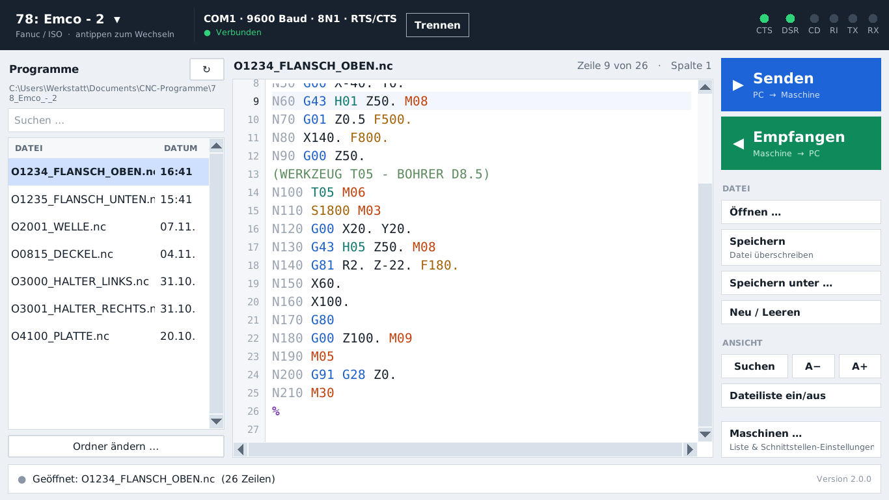

## Was ist neu?

- **Keine verrutschten Zeilen mehr.** Siehe [unten](#warum-sind-die-zeilen-früher-verrutscht).
- **Große Touch-Tasten**: Senden, Empfangen, Öffnen, Speichern.
- **Dateiliste mit Kundenordnern** links: Ordner antippen öffnet ihn, „‹ Zurück“ führt
  zurück. Ein Programm antippen öffnet es. Das Suchfeld durchsucht **alle Kundenordner**
  und zeigt die Treffer nach Ordner sortiert. Antippen von „NAME“ bzw. „DATUM“ sortiert
  die Liste. Das Windows-Dialogfenster mit seinen winzigen Einträgen braucht man nicht mehr.
- **Editor mit Zeilennummern und farbiger G-Code-Darstellung**: G, M, T, F/S, N und Kommentare
  sind farblich unterschieden. Er bietet Suchen sowie Rückgängig (Strg+Z) und
  Wiederholen (Strg+Y). Die Schriftgröße lässt sich mit A− / A+ ändern.
- **Fortschrittsanzeige beim Senden** mit Zeile, Bytes und Zeit. Wartet die Maschine
  (Handshake), zeigt das Programm das an, statt scheinbar hängen zu bleiben.
- **Empfang mit automatischem Ende**: beim zweiten `%` (Fanuc), bei `END PGM`
  (Heidenhain), bei M30 oder wenn einige Sekunden nichts mehr kommt.
- **Programmname wird automatisch erkannt.** Beim Empfang erscheint der Name sofort
  oben im Editor und auf der Taste „Speichern“. Das Speichern-Fenster schlägt ihn vor.
  Erkannt werden:
  - Sinumerik-Werkstücke: `;$PATH=/_N_WKS_DIR/_N_METLOG_300069_WPD` wird zu **METLOG_300069**
  - Sinumerik-Einzelprogramme: `%_N_WELLE_MPF` wird zu **WELLE**
  - Fanuc: `O1234 (FLANSCH)` wird zu **O1234_FLANSCH**
  - Heidenhain: `BEGIN PGM PLATTE` wird zu **PLATTE**
- **Sprungliste für Unterprogramme**: Stehen mehrere Programme in einer Datei
  (z. B. ABSTECH, KANAL1, KANAL2 … in einem Sinumerik-Werkstück), springt man über
  „≡ 8 Programme ▾“ direkt dorthin.
- **Kundenordner wird beim Speichern vorgeschlagen**, siehe [Kundenordner](#kundenordner).
- **Zusammenrücken** auf Knopfdruck: Leerzeilen raus, vor jedem Werkzeug eine Leerzeile,
  siehe [Zusammenrücken](#zusammenrücken).
- **Satznummern** auf Knopfdruck: pro Werkzeug (N1000, N2000 …), durchgehend, nur an
  Werkzeugwechseln oder entfernen, siehe [Nummerieren](#nummerieren).
- **Einrichteblatt als PDF**: Werkzeuge nach Seite 1 / Seite 2 mit dem Kommentar aus dem
  Programm, dazu Spanndruck, Teil und Notizen, siehe [Einrichteblatt](#einrichteblatt).
- **Korrekturblatt als PDF**: Seite 1 links, Seite 2 rechts, je Werkzeug viel Platz für
  Bemerkungen, siehe [Korrekturblatt](#korrekturblatt).
- **Kontur → Code**: Teil mit Maßen eingeben, in der Zeichnung antippen, ob gedreht, gefräst
  oder entgratet wird – auch Flächen, Nuten und Bohrungen auf Winkellagen (C-/Y-Achse).
  Heraus kommt ein fertiges Programm, siehe [Kontur → Code](#kontur--code).
- **Innenbearbeitung**: Vorbohren in Drehmitte, Bohrung mit der Bohrstange schruppen und schlichten
  (G41), Fase/Radius am Bohrungseingang, siehe [Innenbearbeitung](#innenbearbeitung-bohrung).
- **3D-Modell laden (STEP/STL)**: Modell im Kontur-Assistenten öffnen, Drehachse (X0) und Nullpunkt
  Z0 per Klick wählen – Kontur, Fasen/Radien, Bohrung, Schlüsselflächen und Querbohrungen werden
  erkannt und übernommen, siehe [3D-Modell laden](#3d-modell-laden-stepstl).
- **Mantelnut**: Nut auf der Mantelfläche rundherum (Ringnut), schräg/als Wendel oder als Kurvenbahn –
  die C-Achse interpoliert mit X/Z (Siemens `TRACYL`, Fanuc `G07.1`).
- **Nullpunkt Z0 frei wählbar**: „Z0 hinter Stirn“ verschiebt alle Z-Werte im Programm.
- **Werkzeugkatalog**: 52 Wendeschneidplatten (CNMG, CCMT, DNMG, DCMT, VNMG, VCMT, WNMG …),
  32 Außenhalter, 23 Bohrstangen von Ø8 bis Ø40 sowie Bohrer und Fräser – mit ISO-Bezeichnung,
  siehe [Werkzeuge](#werkzeuge-aus-dem-katalog).
- **Simulation** mit echter Plattenform: Drehen außen und innen (Platte, Halter, Bohrstange) und
  Fräsen auf den Winkellagen; meldet Kollisionen, Eilgang ins Material und Restmaterial,
  siehe [Simulation](#simulation).
- **Frässtrategien**: Flächen zickzack/Gleichlauf/Gegenlauf, Nuten in Bahnen, mit Rampe oder
  trochoidal, Bohrungen mit Entspanen/Spanbruch.
- **Bilder lesen (PC-Version)**: Foto der M-/G-Code-Liste laden – das Programm schlägt daraus die
  Felder des Postprozessors vor und legt die Code-Liste bei der Maschine ab. Foto eines Zyklus
  laden – daraus wird ein Zyklus zum Ausfüllen und Einfügen, siehe [Bilder lesen](#bilder-lesen-pc-version).
- **Zyklen je Maschine**: Taste **Zyklen** im Hauptfenster – Werte eintragen, am Cursor einfügen.
- **Fenster passen auf jeden Windows-Bildschirm**: Kontur-Assistent und Dialoge richten sich nach
  dem freien Bereich über der Taskleiste (auch bei 125 %/150 % Skalierung); die Tasten unten
  bleiben immer sichtbar.
- **Postprozessor pro Maschine**: G- und M-Befehle je Maschine einstellbar, z. B. angetriebenes
  Werkzeug `S3=/M3=` oder `S4=/M4=` bei Siemens, C-Achse bei Fanuc, siehe
  [Postprozessor](#postprozessor-pro-maschine).
- **Maschinenliste** mit allen Schnittstellen-Einstellungen je Maschine.
- **LEDs für die Steuerleitungen** CTS, DSR, CD und RI sowie TX/RX, wie im alten Programm.
- **Warnung vor Sonderzeichen** (ä, ö, ü, Ø …), die viele Steuerungen mit Alarm ablehnen.
- Klare Fehlermeldungen auf Deutsch, z. B. „COM1 ist belegt. Läuft noch ein anderes Programm?“

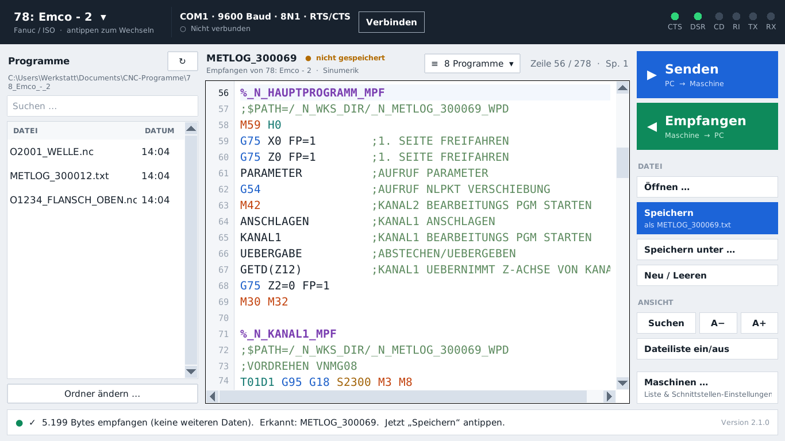

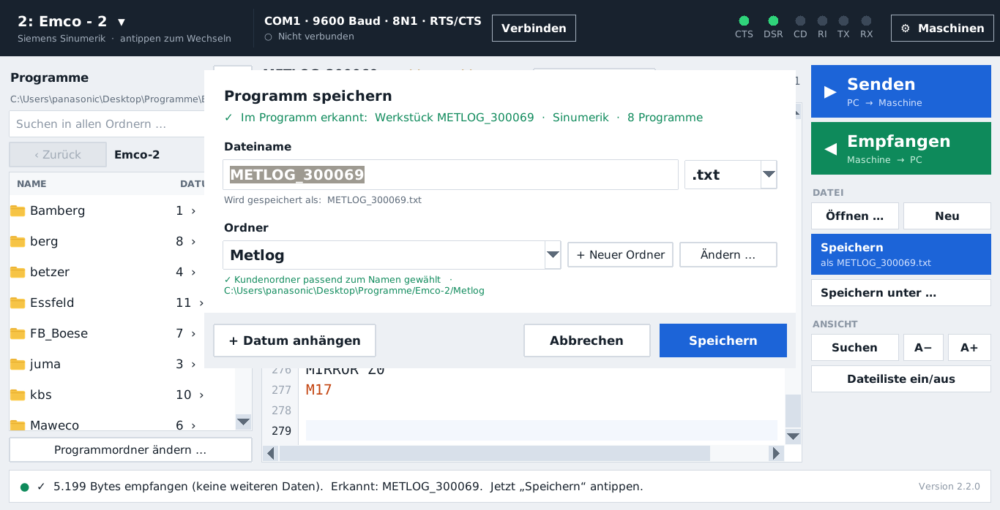

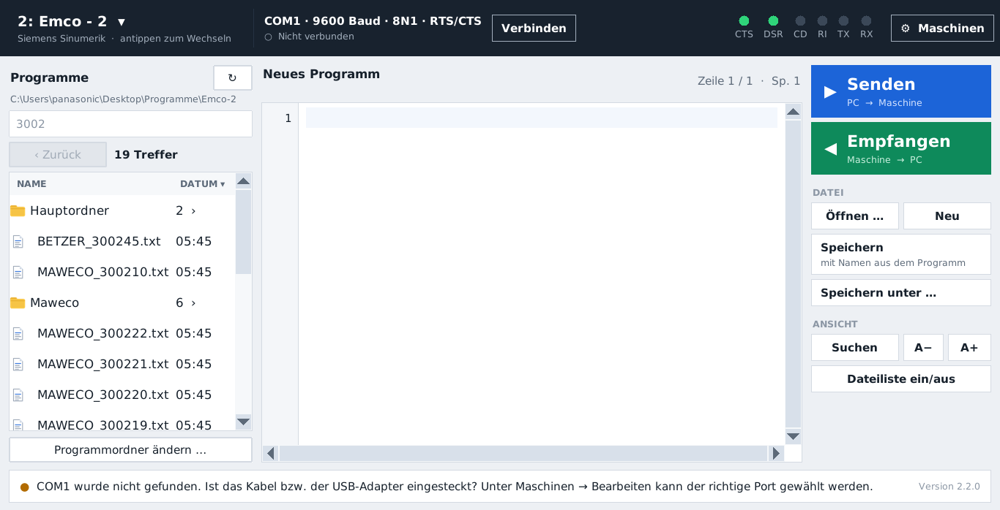

## Installation

### Variante A: fertige EXE (empfohlen)

Bei jedem Hochladen baut GitHub automatisch zwei Programmdateien:

| Datei | Für | Besonderheit |
|---|---|---|
| `CNC-Datenuebertragung.exe` (Artifact **CNC-Datenuebertragung-Windows**) | Toughbook, Windows 7 und neuer | Python 3.8, 32 Bit |
| `CNC-Datenuebertragung-PC.exe` (Artifact **CNC-Datenuebertragung-PC-Windows**) | PC mit Windows 10/11 (64 Bit) | zusätzlich **Bilder lesen** (M-/G-Code-Listen, Zyklen) und Bildvorschau |

Beide lesen dieselben Einstellungen und Programme; alles andere ist gleich.

1. Auf GitHub im Repository auf **Actions** gehen, dann **Windows-Programm bauen** wählen
   und den neuesten grünen Lauf öffnen.
2. Unten bei **Artifacts** die passende Datei herunterladen und entpacken.
3. Die EXE auf das Tablet bzw. den PC kopieren, z. B. auf den Desktop, und starten.
   Eine Installation ist nicht nötig.

Wenn ein Versions-Tag (z. B. `v2.0.0`) angelegt wird, erscheint die EXE zusätzlich unter **Releases**.

Die EXE wird mit Python 3.8 (32 Bit) gebaut. Damit läuft sie auch unter **Windows 7**,
egal ob 32 oder 64 Bit.

> **Windows 7:** Erscheint beim Start eine Meldung wie „api-ms-win-crt-runtime-l1-1-0.dll fehlt“,
> fehlt das Windows-Update **KB2999226** (Universal C Runtime). Nach der Installation
> dieses Updates startet das Programm.

Die EXE kann man auch selbst bauen: Auf einem Windows-PC mit Python 3.8 einfach
`build_exe.bat` doppelklicken (PC-Version: Python 3.12 und `build_exe_pc.bat`). Danach liegt sie in `dist\`.

### Variante B: direkt mit Python

1. Python installieren. Für Windows 7 muss es **Python 3.8.10** sein
   (https://www.python.org/downloads/release/python-3810/), bei der Installation
   „Add Python to PATH“ ankreuzen.
2. Eingabeaufforderung öffnen und `pip install pyserial` eingeben.
3. `CNC-Datenuebertragung.pyw` doppelklicken.

## Erste Schritte

1. Oben rechts auf **⚙ Maschinen** tippen (oder oben links auf den Maschinennamen),
   dann **Bearbeiten …**
2. Unter **Schnittstelle** die Werte der Steuerung eintragen. Für die „78: Emco - 2“
   sind die Werte aus dem alten Programm schon vorbelegt: COM1, 9600 Baud, 8 Datenbits,
   keine Parität, 1 Stoppbit, Hardware-Handshake.
3. Unter **Allgemein** den Programmordner festlegen, wenn die Programme nicht unter
   `Dokumente\CNC-Programme\<Maschine>` liegen sollen. Das geht auch direkt unter der
   Dateiliste mit **Programmordner ändern …**. Gemeint ist der Hauptordner, in dem die
   Kundenordner liegen, z. B. `Desktop\Programme\Emco-2`.
4. Weitere Maschinen mit **Neue Maschine …** oder **Kopieren** anlegen.

Wichtig: Das alte Programm muss geschlossen sein, sonst ist der COM-Port belegt.

### Programm an die Maschine senden

1. Programm links in der Liste antippen oder über **Öffnen …** laden.
2. An der Steuerung das Einlesen starten (z. B. Fanuc: EDIT → READ → EXEC).
3. **Senden** antippen. Der Balken unten zeigt den Fortschritt, **Abbrechen** stoppt sofort.

Die Reihenfolge von Schritt 2 und 3 ist bei Hardware-Handshake egal, denn das Programm
wartet, bis die Steuerung bereit ist.

### Programm von der Maschine holen

1. **Empfangen** antippen. Unten erscheint „Bereit – jetzt an der Steuerung die Ausgabe starten“.
2. An der Steuerung die Ausgabe starten (z. B. Fanuc: EDIT → PUNCH → EXEC).
3. Der Text läuft live in den Editor. Das Ende wird automatisch erkannt. Mit
   **Empfang beenden** lässt sich der Empfang auch von Hand abschließen.
4. **Speichern** antippen. Es öffnet sich ein Fenster mit dem erkannten Namen
   (z. B. `METLOG_300069`). Dort kann man ihn übernehmen oder ändern und die Endung
   wählen (`.txt`, `.nc`, `.mpf` …). Die gewählte Endung merkt sich das Programm je Maschine.
   Gibt es die Datei schon, warnt das Fenster. „+ Datum anhängen“ macht daraus z. B.
   `METLOG_300069_2026-11-10`.
   Unter Maschine → Empfangen kann man stattdessen „automatisch speichern“ einschalten.
   Dann wird ohne Fenster gespeichert, und vorhandene Dateien werden nie überschrieben.

Ist eine Datei schon gespeichert, überschreibt **Speichern** sie direkt.
Der kleine Knopf **unter …** daneben (= Speichern unter) öffnet das Fenster, um einen
anderen Namen oder Ordner zu wählen.

### Sinumerik-Werkstücke mit mehreren Programmen

Ein Werkstück wie `METLOG_300069` enthält mehrere Programme hintereinander, jedes mit
eigenem Kopf `%_N_…_MPF`. Darauf ist das Programm eingestellt:

- Ein `%_N_…`-Kopf beendet den Empfang nicht. Als Programmende zählt nur ein `%`,
  das allein in der Zeile steht (Fanuc).
- Beim Senden wird so ein Werkstück nicht zusätzlich mit `%` eingerahmt.
- Klammern wie `GETD(Z12)` werden nicht als Kommentar eingefärbt.
- Für Sinumerik-Maschinen empfiehlt sich als Programmende „Nur nach Zeit ohne Daten“.
  M30 und M17 kommen in einem Werkstück mehrfach vor und taugen deshalb nicht als Ende.

## Kundenordner

Liegen im Programmordner Unterordner je Kunde (z. B. `Bamberg`, `betzer`, `Metlog` …),
zeigt die Dateiliste sie oben mit Ordnersymbol und Anzahl der Programme an.

Beim **Speichern** wählt das Programm den Ordner selbst vor. Dabei gilt diese Reihenfolge:

1. Gibt es das Programm schon, z. B. `METLOG_300069.txt` in `Metlog`, wird dieser Ordner gewählt.
2. Sonst wird der Kundenordner gewählt, mit dessen Namen das Programm beginnt.
   `METLOG_300069` landet so in `Metlog`, `BETZER_300245` in `betzer`.
3. Sonst wird der Ordner gewählt, der gerade in der Liste geöffnet ist.
4. Sonst wird der Hauptordner gewählt.

Im Speichern-Fenster lässt sich der Ordner aus einer Liste aller Kundenordner antippen.
Mit **+ Neuer Ordner** legt man einen neuen Kundenordner an.

## Zusammenrücken

Die Taste **Zusammenrücken** (rechts unter „BEARBEITEN“) räumt das Programm auf:

- **Alle Leerzeilen werden entfernt**, ebenso Leerzeichen am Zeilenende. Leerzeichen
  *innerhalb* einer Zeile (`G01 X10 Z-5`) bleiben, die braucht die Steuerung.
- **Vor jedem Werkzeugaufruf steht danach genau eine Leerzeile.** Als Werkzeugaufruf
  zählen z. B. `T12D1`, `N30 T01 M06`, `T="BOHRER"` und `TOOL CALL`, nicht aber ein
  Kommentar wie `(WERKZEUG T01)`.
- **Kommentarzeilen direkt über dem Werkzeug** (z. B. `;FERTIGDREHEN VCMT04`) bleiben
  beim Werkzeug. Die Leerzeile kommt über den Kommentar. Das gilt auch, wenn zwischen
  Kommentar und Werkzeug noch bis zu drei Sätze ohne Achsbewegung stehen (z. B. `M5`,
  `G04 F0.2`, `STOPRE`):
  ```
  G00 X100 Z100
  M5

  ;FRAESEN 5MM
  M5
  T07D1 G94 G18 S3=3500 M3=3
  ```
  Auf Einricht- und Korrekturblatt bekommt T7 dann auch die Bezeichnung „FRAESEN 5MM“.
- **Direkt nach einem Programmkopf** (`%_N_…_MPF`, `;$PATH=…`, `O1234`) kommt kein Abstand.
- **Mehrere Programme in einer Datei** (Sinumerik-Werkstück) bleiben durch zwei
  Leerzeilen vor jedem weiteren `%_N_…`-Kopf getrennt.
- **Heidenhain** erlaubt keine Leerzeilen. Dort werden nur Leerzeilen entfernt.

Zweimal Zusammenrücken ändert nichts mehr. Mit **↶ Rückgängig** über dem Editor holt man
den alten Stand mit einem Tipp zurück. Gespeichert wird erst mit „Speichern“.

## Nummerieren

Die Taste **Nummerieren …** (rechts unter „BEARBEITEN“) setzt Satznummern. Im Fenster
wählt man das Schema und sieht vorher eine Vorschau:

| Schema | Beispiel | Wofür |
|---|---|---|
| **Pro Werkzeug** (empfohlen) | `N1000 T01D1 …`, `N1010 …` / `N2000 T02D1 …` | Die Nummer zeigt das Werkzeug. Nach Werkzeugbruch steigt man z. B. bei N3000 wieder ein. Sätze vor dem ersten Werkzeug: N10, N20 … |
| **Durchgehend** | `N10`, `N20`, `N30` … | klassisch |
| **Nur Werkzeugwechsel** | `N1 T01D1 …`, `N2 T02D1 …` | nur die Werkzeugzeilen bekommen eine Nummer |
| **Nummern entfernen** | | Sinumerik braucht keine N-Nummern, das Programm wird kürzer |

- Jedes Programm einer Datei (`%_N_…_MPF`, `O1234`) fängt wieder vorne an.
- Keine Nummer bekommen Kommentarzeilen, Leerzeilen, Programmköpfe, `;$PATH=`,
  Sprungmarken (`ENDE:`) und `%`. Vorhandene Nummern werden ersetzt.
- Die Schrittweite (10, 5, 2, 1) ist wählbar. Das Programm merkt sich die letzte Wahl.
- **Verweise auf Satznummern werden mitgeführt:** Fanuc-Zyklen `G70`–`G73 P… Q…`,
  `GOTO n`, `M99 Pn` und Sinumerik `GOTOF/GOTOB Nn`. Zeigt ein Verweis ins Leere oder
  auf eine doppelte Nummer, ändert das Programm nichts und sagt warum.
  Programme mit solchen Verweisen können nicht entnummeriert werden.
- Bei Heidenhain werden die Sätze lückenlos 0, 1, 2 … durchgezählt.
- Mit **↶ Rückgängig** ist alles mit einem Tipp zurückgenommen.

## Einrichteblatt

Die Taste **Einricht-/Korrekturblatt** (rechts unter „BEARBEITEN“) öffnet ein Fenster für
beide Blätter. **Einrichteblatt-PDF** erstellt das Einrichteblatt als PDF,
das auf eine A4-Seite passt. Man kann es ausdrucken, an die Maschine hängen oder einfach
als Datei beim Programm lassen.

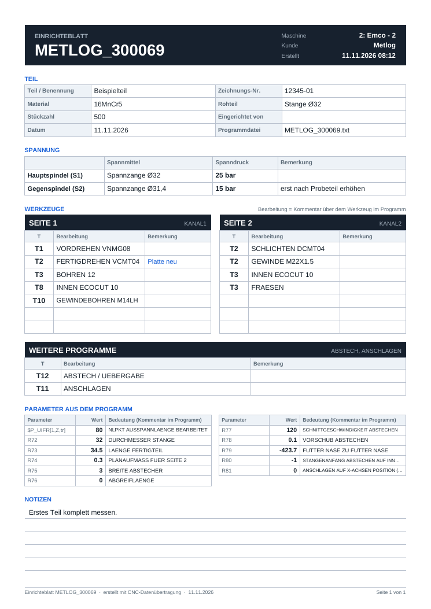

**Automatisch aus dem Programm:**
- **Werkzeuge je Seite:** Kanal 1 = Seite 1, Kanal 2 = Seite 2 (Sinumerik-Programme
  `%_N_KANAL1_MPF` / `%_N_KANAL2_MPF`). Die **Bearbeitung** ist der Kommentar direkt über
  dem Werkzeug: aus `;FERTIGDREHEN VCMT04` + `T02D1 …` wird „T2 – FERTIGDREHEN VCMT04“.
  Werkzeuge aus anderen Unterprogrammen (z. B. ABSTECH, ANSCHLAGEN) stehen unter
  „Weitere Programme“. Bei Programmen ohne Kanäle (z. B. Fanuc) gibt es eine Liste.
  Eine Kommentarzeile wie `(SEITE 2)` schaltet ab dort auf Seite 2 um.
- **Parameter:** Kommentierte Werte aus einem Parameter-Programm,
  z. B. `R72=32 ;DURCHMESSER STANGE`.
- **Kopf:** Programmname, Kunde (aus dem Kundenordner), Maschine, Datum.

**Selbst eintragen** (wird neben dem Programm gespeichert und beim nächsten Mal wieder angezeigt):
- je Werkzeug eine **Bemerkung**, die Bearbeitung lässt sich auch ändern (Zeile antippen)
- Teil, Zeichnungs-Nr., Material, Rohteil, Stückzahl, eingerichtet von, Datum
- **Spannmittel und Spanndruck** für Haupt- und Gegenspindel
- Notizen

Auf dem Blatt bleiben unter jeder Werkzeugliste zwei leere Zeilen und unten Notizlinien
zum Nachtragen mit dem Stift.

**Dateien:** Neben `METLOG_300069.txt` entstehen `METLOG_300069_Einrichteblatt.pdf` (wird in
der Dateiliste angezeigt, Antippen öffnet sie im PDF-Programm) und
`METLOG_300069.einrichteblatt.json` mit den eigenen Eingaben (in der Liste ausgeblendet).

## Korrekturblatt

Im selben Fenster gibt es den Reiter **Korrekturblatt** und unten die Taste
**Korrekturblatt-PDF**. **Seite 1 steht links, Seite 2 rechts.** Pro Seite gibt es 12 Zeilen mit
den Spalten **T · Funktion · Werkzeug · Bemerkung**.

**Hochkant oder quer:** Im Reiter oben rechts „Blatt: Hochkant / Quer“ wählen. Hochkant
gibt höhere Zeilen, quer breitere Spalten (mehr Platz für Bemerkungen). Die Wahl wird
gemerkt.

| Hochkant | Quer |
|---|---|
| 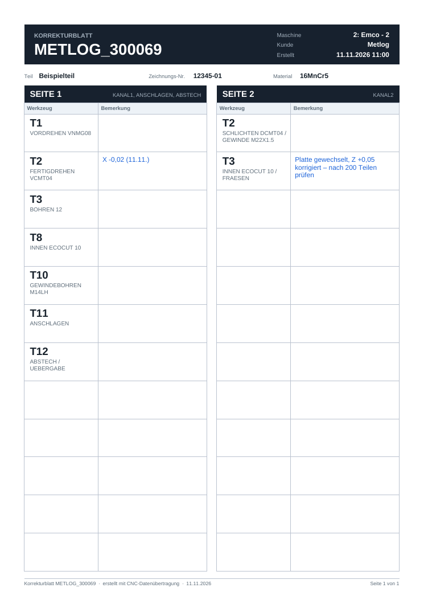 | 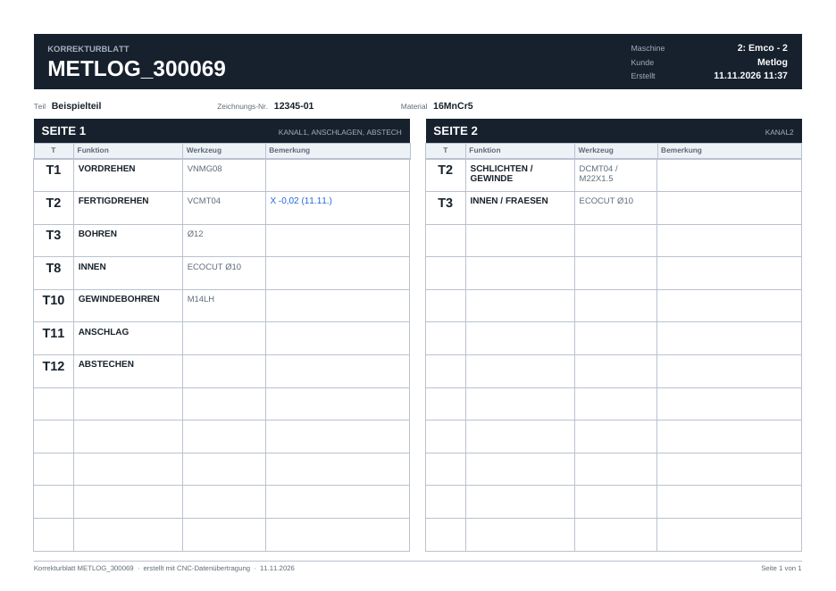 |

**Funktion und Werkzeug** werden automatisch aus dem Kommentar über dem Werkzeug getrennt:

| Kommentar im Programm | Funktion | Werkzeug |
|---|---|---|
| `;VORDREHEN VNMG08` | VORDREHEN | VNMG08 |
| `;BOHREN 12` | BOHREN | Ø12 (Zahl = Durchmesser) |
| `;INNEN ECOCUT 10` | INNEN | ECOCUT Ø10 |
| `;GEWINDE M22X1.5` | GEWINDE | M22X1.5 |
| `;FRAESER 20` | FRAESEN | FRAESER Ø20 |

Erkannt werden Wendeplatten (DCMT…, VNMG…, CCMT…), Zahlen als Durchmesser, Gewinde (M…),
Radien (R0.8) und Werkzeugarten (Bohrer, Fräser, EcoCut …). Ist die Trennung einmal falsch,
lässt sie sich per Antippen der Zeile von Hand ändern.

- **Abstechwerkzeug und Anschlag** stehen automatisch auf **Seite 1** (hinten) und heißen
  nach ihrer Funktion **ABSTECHEN** bzw. **ANSCHLAG**. Programmnamen wie UEBERGABE oder
  STANGENWECHSEL gehören nicht in die Bezeichnung.
- Gleiches Werkzeug auf einer Seite steht nur einmal, auch wenn es mehrfach aufgerufen
  wird (z. B. T12 in KANAL1 und in ABSTECH).
- **Seite 1 und Seite 2 werden nie zusammengefasst:** Bei zwei Kanälen hat jede Seite
  ihren eigenen Revolver, T2 auf Seite 1 ist also ein anderes Werkzeug als T2 auf Seite 2.
- **Zeile antippen:** Dort lassen sich **Seite** (z. B. Anschlag auf Seite 2), **Funktion**,
  **Werkzeug** und **Bemerkung** ändern. Das wird gespeichert.

Die Datei heißt z. B. `METLOG_300069_Korrekturblatt.pdf` und liegt neben dem Programm.

## Kontur → Code

Die Taste **Kontur → Code** (rechts unter „BEARBEITEN“) öffnet den Kontur-Assistenten:
Maße des Teils eingeben, in der Zeichnung ein Element antippen und sagen, was damit passiert –
**drehen**, **fräsen** (auch auf Winkellagen mit C- und Y-Achse) oder **entgraten**. Daraus
entsteht ein Programm im Stil der vorhandenen Programme – mit den G- und M-Befehlen der Maschine
aus ihrem [Postprozessor](#postprozessor-pro-maschine) (Sinumerik oder Fanuc).

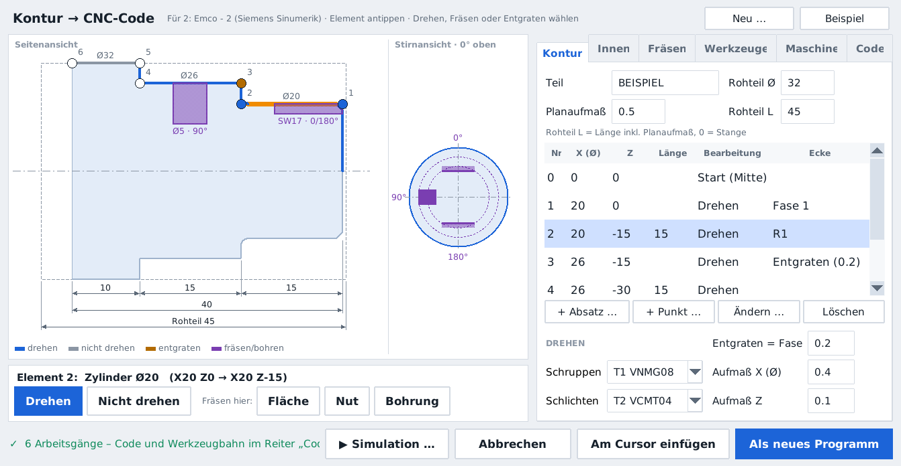

### So geht's

1. **Reiter „Kontur“**: Rohteil-Ø, Planaufmaß und **Rohteil-Länge** (inkl. Planaufmaß, `0` = Stange)
   eintragen. Die Kontur wird von der Stirnseite (Nullpunkt X0 Z0 in der Mitte) nach links eingegeben:
   - **+ Absatz …**: Durchmesser und Länge, z. B. Ø20 × 15, dann Ø26 × 15. Die Punkte setzt das
     Programm selbst.
   - **+ Punkt …**: einzelner Punkt mit X (Ø) und Z, z. B. für einen Kegel.

   Die Zeichnung ist bemaßt: Durchmesser an den Absätzen, darunter die **Längen** der
   Konturabschnitte, die **Gesamtlänge** der Kontur und die **Rohteil-Länge**. Die Punktliste zeigt
   die Länge jedes Abschnitts ebenfalls. Ist die Kontur länger als das Rohteil, meldet der
   Assistent das.

   Bohrung im Teil? → Reiter **„Innen“**, siehe [Innenbearbeitung](#innenbearbeitung-bohrung).
2. **In der Zeichnung antippen:**
   - **Element** (Linie): **Drehen** oder **Nicht drehen**. Unter „Fräsen hier“ legt man direkt
     eine Fläche, Nut oder Bohrung an dieser Stelle an (Z-Bereich wird übernommen).
   - **Punkt** (Kreis an der Ecke): **Scharf**, **Entgraten** (kleine Fase, Größe unter
     „Entgraten = Fase“), **Fase …** oder **Radius …**.
   - **Fräsung**: ändern, Entgraten ein/aus, löschen.
3. **Reiter „Fräsen“** – Fräsungen und Bohrungen auf Winkellagen:

   | Art | Werkzeug | Eingaben |
   |---|---|---|
   | Fläche / Mehrkant | Fräser, radial (Y-Achse) | Z rechts/links, Schlüsselweite |
   | Längsnut | Fräser, radial (Y-Achse) | Z rechts/links, Breite, Tiefe |
   | Bohrung radial | Bohrer, radial | Z, Ø, Tiefe |
   | Bohrung Stirnseite | Bohrer, axial | Lochkreis-Ø, Ø, Tiefe |
   | Mantelnut (C-Achse) | Fräser, radial, TRACYL/G07.1 | Bahn: umlaufend, von–bis (Z/C, auch über 360°) oder Punkte; Breite, Tiefe |

   Die **Winkel C** trägt man einfach ein (`0 180`, `0 120 240`) oder verteilt sie mit
   **2× / 3× / 4× / 6×** gleichmäßig. Die **Stirnansicht** rechts in der Zeichnung zeigt die
   Lagen (0° oben). „Kanten entgraten“ fährt danach mit einem 90°-Fasenfräser die Kanten der
   Fläche/Nut ab bzw. senkt die Bohrungen an. Kanten auf der **Mantelfläche** (Nut, Bögen am
   Flächenende) werden dabei mit **Zylinder-Interpolation** entgratet – die Spindel dreht mit,
   siehe unten.
   Im Fenster einer Fräsung wählt man auch die **Strategie**:

   | Fräsung | Strategien |
   |---|---|
   | Fläche | Zickzack (hin und her), nur Gleichlauf, nur Gegenlauf |
   | Nut | in Bahnen (Mitte, dann Seiten), mit Rampe eintauchen (3°), trochoidal (Wirbelfräsen) |
   | Bohrung | Entspanen (ganz raus), Spanbruch (kurz zurück), in einem Zug |
   | Mantelnut | schräg eintauchen (Wendel / Pendeln), senkrecht eintauchen |
4. **Reiter „Werkzeuge“**: Revolverbelegung mit T-Nummer, Bezeichnung (kommt in den Kommentar),
   Art, Lage, Halter und Platte bzw. Bohrer/Fräser aus dem [Katalog](#werkzeuge-aus-dem-katalog),
   Ø, Drehzahl, Vorschub und Zustellung.
5. **Reiter „Maschine“**: Maschine wählen, ihr [Postprozessor](#postprozessor-pro-maschine),
   Sicherheitsabstand.
6. **Reiter „Code“**: fertiges Programm und die Werkzeugbahn in der Zeichnung (gestrichelt
   Eilgang, durchgezogen Vorschub). **▶ Simulation …** spielt das Programm mit Plattenform ab
   (siehe [Simulation](#simulation)). Dann **Als neues Programm** (mit Programmanfang und -ende,
   z. B. `%_N_…_MPF` … `M30`) oder
   **Am Cursor einfügen**, z. B. in ein vorhandenes KANAL1-Programm. Speichern und Senden wie gewohnt.

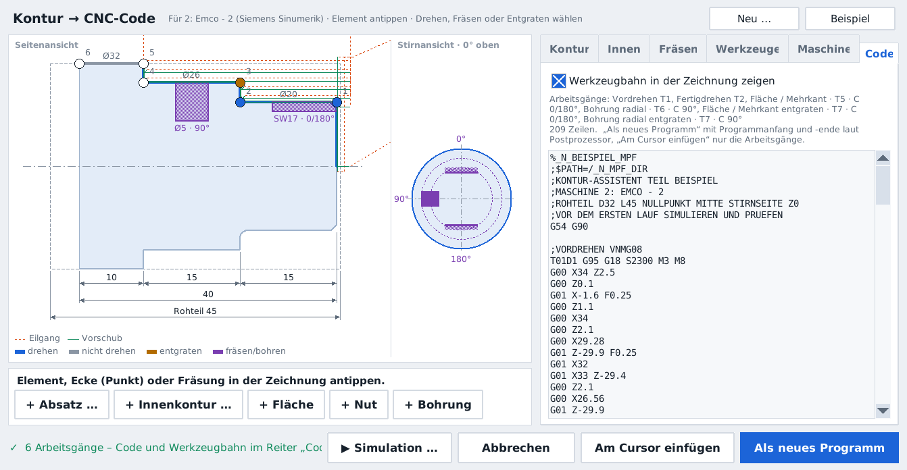

### 3D-Modell laden (STEP/STL)

Im Kontur-Assistenten oben **3D-Modell …** und die Datei wählen. **STL** (ASCII oder binär) geht
überall, auch auf dem Toughbook; **STEP/STP** liest die **PC-Version** (mit Open CASCADE) – dort
werden Flächen genau erkannt, auch Querbohrungen.

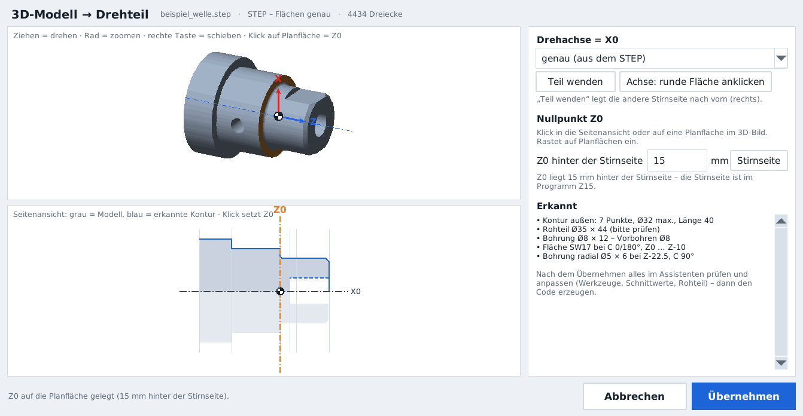

- **3D-Bild**: ziehen = drehen, Mausrad = zoomen, rechte Taste = schieben; Ansicht 3D/Seite/Stirn.
- **Drehachse = X0**: vorgeschlagen wird die beste Achse (STEP: genau aus den Zylinderflächen).
  Andere Achse aus der Liste oder „Achse: runde Fläche anklicken“. **Teil wenden** legt die andere
  Stirnseite nach vorn.
- **Nullpunkt Z0**: Klick in die Seitenansicht oder auf eine Planfläche im 3D-Bild (rastet auf
  Planflächen ein) oder Wert eintragen. Liegt Z0 hinter der Stirnseite, steht die Stirnseite im
  Programm z. B. bei `Z15`; alle Z-Werte werden verschoben, gezeichnet wird weiter ab der Stirnseite.
- **Erkannt** (Liste rechts, blau in der Seitenansicht): Außenkontur mit Fasen und Radien, Rohteil,
  Bohrung/Vorbohren bzw. Innenkontur, Schlüsselflächen, Bohrungen radial und an der Stirnseite.
  Hinweise nennen, was nicht übernommen wird (Einstiche, Rückseite = 2. Aufspannung).
- **Übernehmen** ersetzt Kontur und Fräsungen des Teils; Werkzeuge und Postprozessor bleiben. Danach
  alles prüfen, ggf. anpassen und den Code erzeugen.

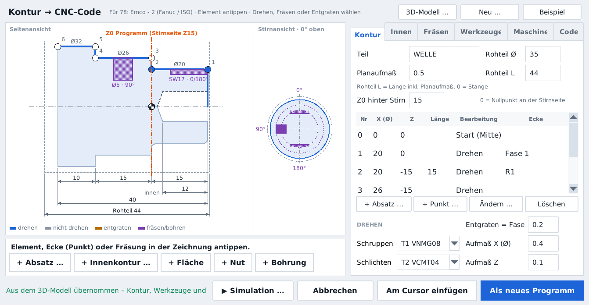

Das Feld **„Z0 hinter Stirn“** im Reiter „Kontur“ gibt es auch ohne Modell (`0` = Stirnseite).

### Was erzeugt wird

Je Arbeitsgang ein Kommentar über dem Werkzeug – so erkennen Einricht- und Korrekturblatt die
Bearbeitung. Drehen wird achsparallel geschruppt (Stufen entlang der Kontur nachgezogen,
Aufmaß X/Z bleibt stehen) und mit Schneidenradiuskorrektur G42 geschlichtet:

```
;FERTIGDREHEN VCMT04
T02D1 G95 G18 S2500 M3 M8
G00 X0 Z2
G42 G01 Z0 F0.1
G01 X18
G01 X20 Z-1
G01 Z-14
G02 X22 Z-15 CR=1
…
G40 G00 X150
G00 Z130
```

Fräsen und Bohren: Hauptspindel aus, positionieren (`SPOS=DC(Winkel)`), angetriebenes Werkzeug
ein (`S3=… M3=3`), Vorschub `G94`, Ebene `G19` (radial, Y-Achse) bzw. `G17` (axial). Eingetaucht
wird nur außerhalb des Teils, zum Schluss `Y0`, Werkzeug aus (`M3=5`), Wechselpunkt und `G18`:

```
;FRAESEN FLAECHE SW17 FRAESER D8
T05D1 G94 G19 M8
M5
SPOS=DC(0)
S3=3000 M3=3
G00 Y-10.268 Z-3
G00 X24
G01 X18.5 F300
G01 Y10.268
…
SPOS=DC(180)
…
```

Entgraten auf der Mantelfläche – die C-Achse interpoliert mit X und Z (Siemens `TRACYL`, Fanuc
`G07.1`). Der Fasenfräser steht immer radial; programmiert wird auf der Abwicklung (Siemens: Y in mm,
Fanuc: C in Grad). Weil die Nutwände parallel (mit der Y-Achse gefräst) und nicht radial stehen,
taucht er an den Längswänden etwas tiefer ein, damit die Fase dort die eingestellte Größe hat:

```
;ENTGRATEN NUT 6X3 FASENFRAESER 90
T07D1 G94 G19 M8
M5
SPOS=DC(13.342)
S3=4000 M3=3
G00 Z-19.5
G00 X30
TRACYL(26)
G01 X25.278 F400
G01 Y3.027 Z-22.5
G01 X25.284 Y2.94 Z-23.147
…
TRAFOOF
G00 X30
```

C wird vor dem Einschalten positioniert, im Zylinderbetrieb gibt es nur `G01` (Fanuc erlaubt dort kein
`G00`), erst ausschalten, dann frei fahren. Die gerade Kante einer Fläche an der Stirnseite folgt danach
mit stehender Spindel und Y-Achse. Hat eine Maschine keine Zylinder-Interpolation, nimmt man im
Postprozessor (Reiter „Mantel“) den Haken weg – dann wird wie früher mit X/Y/Z entgratet.

**Mantelnut**: C positionieren, Zylinder-Interpolation ein, schräg (Wendel/Pendeln) oder senkrecht
eintauchen, die Bahn abfahren (Bögen in höchstens 90°-Stücken), bei breiten Nuten mehrere Bahnen
nebeneinander, aus, frei fahren. Die Simulation zeigt die Abwicklung des Mantels.

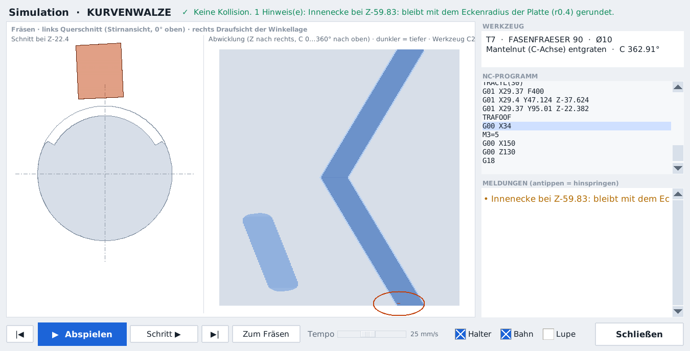

Die Eingaben zum Teil werden gemerkt (`kontur.json` neben der `config.json`).

### Innenbearbeitung (Bohrung)

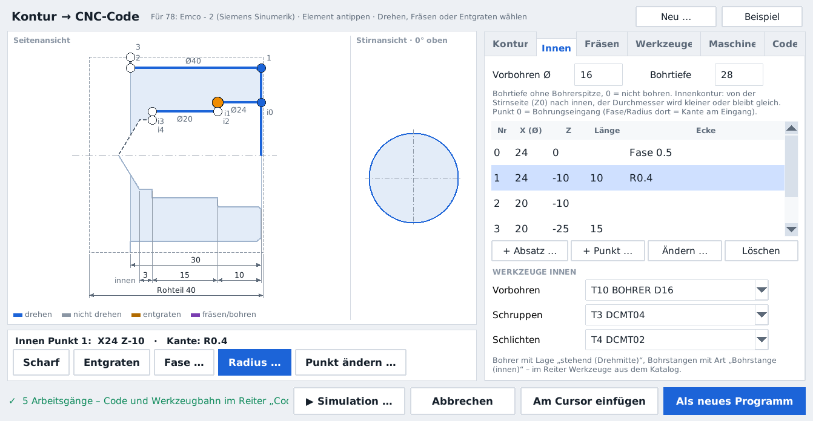

1. **Vorbohren Ø** und **Bohrtiefe** eintragen (Tiefe mit vollem Durchmesser, die Bohrerspitze rechnet
   das Programm dazu). Nur bohren ohne Innenkontur geht auch.
2. Die **Innenkontur** wie außen eingeben, aber von der Stirnseite **nach innen**: **+ Absatz …**
   mit Ø und Länge, z. B. Ø24 × 10, dann Ø20 × 15, zum Schluss Ø16 mit Länge 0 (Bohrungsgrund bis auf
   die Vorbohrung). Der Durchmesser wird nach innen kleiner oder bleibt gleich.
3. In der Zeichnung die **Ecken** antippen (Punkte `i0`, `i1` …): Fase oder Radius. `i0` ist die
   Kante am Bohrungseingang. Die Bohrung erscheint weiß im Schnitt, die Vorbohrung gestrichelt,
   unter dem Teil eine eigene Maßkette „innen“.
4. **Werkzeuge innen**: Bohrer mit Lage „stehend (Drehmitte)“ (Standard: T10 Ø16) und zwei
   Bohrstangen (Standard: T3 A12M-SDUCR07 mit DCMT 070204-M zum Schruppen, T4 mit DCMT 070202-F
   zum Schlichten).

Reihenfolge im Programm: Vordrehen außen → Vorbohren → Innen vordrehen → Fertigdrehen außen →
Innen fertigdrehen → Fräsen. Die Bohrstange stellt von der Vorbohrung aus nach außen zu, zieht
jede Stufe an der Kontur nach und fährt immer erst in Z aus der Bohrung, dann in X zum Wechselpunkt:

```
;VORBOHREN BOHRER D16
T10D1 G95 G18 S900 M3 M8
G00 X0 Z2.5
G01 Z-10.936 F0.12
G00 Z2.5
G00 Z-10.436
…
;INNEN FERTIGDREHEN DCMT02
T04D1 G95 G18 S2200 M3 M8
G00 X25 Z2.5
G41 G01 Z0 F0.08
G01 X24 Z-0.5
G01 Z-9.6
G03 X23.2 Z-10 CR=0.4
G01 X20
G01 Z-25
G01 X16
G01 X15
G40 G00 Z2.5
G00 X150
G00 Z130
```

### Werkzeuge aus dem Katalog

Im Reiter „Werkzeuge“ wählt man **Halter und Platte** (Drehen) bzw. **Bohrstange und Platte**
(innen) oder **Bohrer/Fräser** aus einem Katalog. Die Platte passt immer zum Halter (Form, Größe,
Freiwinkel); die Bezeichnung (z. B. `DCMT04`) wird vorgeschlagen und steht später im Kommentar.

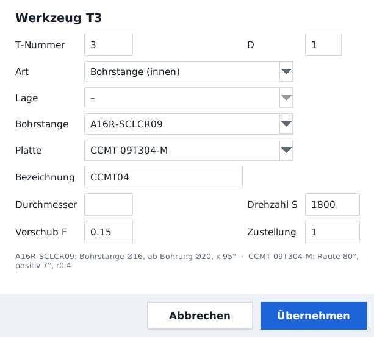

| Katalog | Auswahl |
|---|---|
| Wendeschneidplatten (ISO 1832) | CNMG, CCMT, CCGT, DNMG, DCMT, DCGT, VNMG, VCMT, VCGT, VBMT, WNMG, TNMG, TCMT, SNMG, SCMT, RCMT in üblichen Größen und Eckenradien 0,2 … 1,2 |
| Außenhalter (ISO 5608) | PCLNR/L 95°, PDJNR/L 93°, PDNNN/PDNNR 63°, PVJNR 93°, PWLNR 95°, PTGNR 91°, PSBNR 75°, PSSNR 45°, SVJBR/SVJCR 93°, SVHBR 107,5°, SVVBN 72,5°, SDJCR, SCLCR, STGCR, SRDCN – Schaft 16 bis 32 mm |
| Bohrstangen (ISO 6261) | A08H … A25T (Stahl mit Kühlung) und S20S … S40T: SCLCR, SDUCR, SVUCR, SVUBR, PCLNR, PDUNR, PTFNR, PWLNR – ab Bohrung Ø10 bis Ø50 |
| Bohrer, Fräser | VHM-Bohrer Ø3 … Ø14, HSS-Bohrer Ø16 … Ø25, Wendeplattenbohrer Ø16 … Ø32, NC-Anbohrer, VHM-Fräser Ø3 … Ø20, Fasenfräser 90° |

Die Bohrstangen haben die **kleinste Bohrung (Dmin)** und den **Abstand Achse–Schneidenecke (f1)**
hinterlegt. Der Assistent prüft damit, ob die Stange in die Vorbohrung passt; die Simulation
prüft die Stange auf beiden Seiten der Achse gegen die Bohrungswand.

> Dmin, f1 und Längen sind Richtwerte aus Herstellerkatalogen (Sandvik, Walter, Kennametal,
> Tungaloy, Pramet, ZCC-CT, Phantom). Je nach Hersteller weichen sie um 1–2 mm ab – bei knappen
> Bohrungen das Datenblatt der eigenen Stange prüfen.

### Simulation

**▶ Simulation …** spielt das Programm im Schnitt durch die Drehachse ab – mit der echten Form
von Platte, Halter und Bohrstange (aus dem Katalog) bzw. des Bohrers. Abspielen, Schritt für Schritt,
Lupe; die aktive NC-Zeile ist markiert. Mit G41/G42 fährt der Schneidenradius die versetzte
Bahn wie an der Steuerung.

Das **Tempo** wird in mm Bahn je Sekunde eingestellt (2 … 1000 mm/s, Eilgang fünfmal so schnell).
Abgespielt wird mit etwa 60 Bildern je Sekunde in Schritten von 0,25 mm (Fräsen 0,5 mm) – gedacht
für den PC; auf dem Toughbook läuft die Simulation auch, nur weniger flüssig.

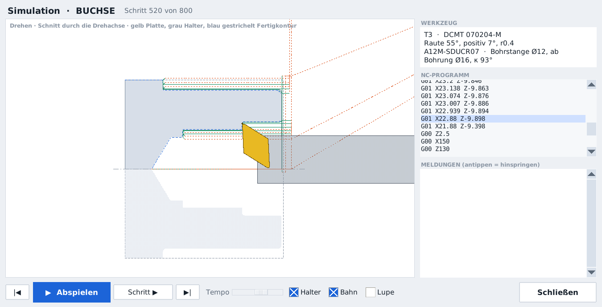

Gemeldet werden (antippen = an die Stelle springen):

- **Eilgang ins Material**, Platte schneidet in die **Fertigkontur** (außen und innen)
- **Halter stößt an**, **Bohrstange stößt an die Bohrungswand** (oben oder unterhalb der Achse),
  Bohrstange fährt ins volle Material (Vorbohren vergessen)
- **Restmaterial** außen und in der Bohrung; Innenecken, die mit dem Eckenradius der Platte gerundet
  bleiben, als Hinweis

Danach folgt das **Fräsen**: links der Querschnitt (Stirnansicht), rechts die Draufsicht der
jeweiligen Winkellage mit Tiefe als Farbe – hier eine Nut trochoidal:

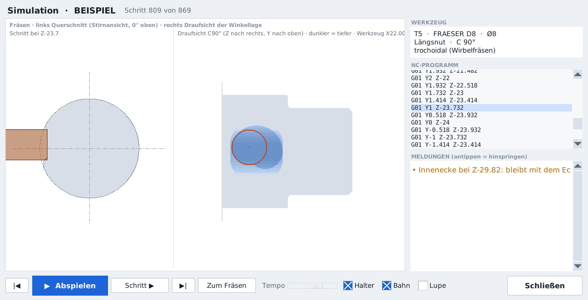

### Postprozessor (pro Maschine)

Welche G- und M-Befehle im Programm stehen, legt der **Postprozessor der Maschine** fest. Jede
Maschine in der Maschinenliste hat ihren eigenen: **⚙ Maschinen → Bearbeiten → Reiter
„Postprozessor“** oder im Kontur-Assistenten im Reiter **„Maschine“** (dort wählt man auch die
Maschine). Rechts zeigt eine Vorschau sofort, wie der Code damit aussieht.

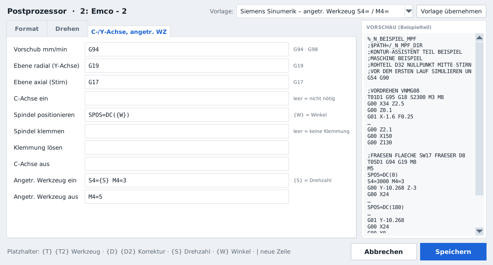

Fertige **Vorlagen** zum Übernehmen:

| Vorlage | Werkzeug | Drehen | Positionieren | Angetr. Werkzeug | Format |
|---|---|---|---|---|---|
| Siemens Sinumerik S3 | `T01D1` | `G95 G18 S… M3 M8` | `SPOS=DC(90)` | `S3=3000 M3=3` … `M3=5` | `;Kommentar`, `CR=` |
| Siemens Sinumerik S4 | `T01D1` | `G95 G18 S… M3 M8` | `SPOS=DC(90)` | `S4=3000 M4=3` … `M4=5` | `;Kommentar`, `CR=` |
| Fanuc C-Achse | `T0101` | `G99`, `G97 S… M3`, `M8` | `G00 C90.` | `M13 S3000` … `M15` | `(Kommentar)`, `R`, `X20.` |

Einstellbar sind:

- **Format**: Steuerung (Sinumerik/Fanuc), Kommentar (`;{TEXT}` oder `({TEXT})`), Programmanfang
  (z. B. `%_N_{NAME}_MPF` oder `%|O{NR} ({NAME})`), Startsatz (`G54 G90`), Programmende,
  Kreisradius (`CR=` oder `R`), Dezimalpunkt immer schreiben (Fanuc: `X20.` statt `X20`, das sonst
  als 0,02 mm gelesen wird), alles in einer Zeile oder getrennt.
- **Drehen**: Werkzeugaufruf (`T{T2}D{D}` → `T01D1`, `T{T2}{D2}` → `T0101`), Vorschub mm/U (`G95`/`G99`),
  Ebene (`G18`), Hauptspindel ein/aus, Kühlmittel ein/aus, Werkzeugwechselpunkt X/Z.
- **C-/Y-Achse, angetriebenes Werkzeug**: Vorschub mm/min (`G94`/`G98`), Ebenen radial/axial
  (`G19`/`G17`), C-Achse ein/aus, Spindel positionieren (`{W}` = Winkel), Klemmen/Lösen,
  angetriebenes Werkzeug ein/aus (`{S}` = Drehzahl).
- **Mantel (TRACYL/G07.1)**: Zylinder-Interpolation zum Entgraten an/aus, Zylinder ein
  (`TRACYL({ZD})` bzw. `G07.1 C{ZR}`), Ebene (Fanuc `G19 W0 H0`), Zylinder aus (`TRAFOOF` bzw.
  `G07.1 C0.`), Umfangsachse (`Y` in mm bzw. `C` in Grad).

Platzhalter: `{T}` `{T2}` Werkzeug, `{D}` `{D2}` Korrektur, `{S}` Drehzahl, `{W}` Winkel,
`{NAME}` Programmname, `{NR}` Programmnummer, `{TEXT}` Kommentar, `{ZD}` `{ZR}` Durchmesser/Radius
für die Zylinder-Interpolation. Ein `|` beginnt eine neue Zeile.

So sieht derselbe Arbeitsgang mit der Fanuc-Vorlage aus:

```
(FRAESEN FLAECHE SW17 FRAESER D8)
T0501
G19 G98
M8
M5
G00 C0.
M13 S3000
G00 Y-10.268 Z-3.
…
G00 C180.
…
G00 Y0.
M15
M9
G00 X150.
G00 Z130.
G18
```

> Bei Fanuc sind die Befehle für C-Achse und angetriebenes Werkzeug je Hersteller verschieden.
> Die Vorlage ist ein Beispiel; „C-Achse ein/aus“ ist leer, bis man die Befehle aus dem
> Maschinenhandbuch einträgt – solange zeigt der Assistent einen Hinweis.

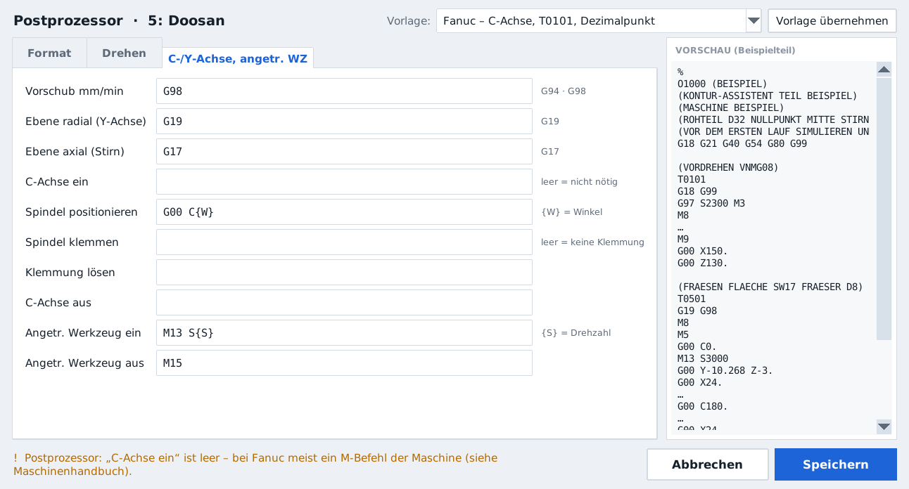

### Bilder lesen (PC-Version)

Fotos oder Bildschirmfotos aus dem Maschinenhandbuch bzw. von der Steuerung kann das Programm lesen
lassen – von **Claude**, der KI von Anthropic. Das gibt es nur in der **PC-Version**
(`CNC-Datenuebertragung-PC.exe`, Windows 10/11) und nur mit Internet.

**Einmal einrichten:** auf [console.anthropic.com](https://console.anthropic.com) anmelden,
unter „API Keys“ einen Schlüssel erstellen und unter „Billing“ Guthaben aufladen. Im Programm
**⚙ Maschinen → API-Schlüssel …** eintragen (oder Windows-Umgebungsvariable `ANTHROPIC_API_KEY`).
Ein Bild kostet je nach Größe etwa 2 bis 15 Cent.

**M-/G-Code-Liste → Postprozessor:** im Postprozessor der Maschine **📷 Aus Bildern lesen …**,
ein oder mehrere Fotos der Liste wählen. Nach 20–60 Sekunden zeigt ein Fenster je Feld den jetzigen
Wert, den Vorschlag und die Stelle im Bild. Sichere Vorschläge sind angehakt, unsichere und
unbrauchbare (z. B. Spindel ein ohne `{S}`) nicht – antippen schaltet um. **Übernehmen** trägt die
Werte ein; die Vorschau zeigt sofort das Ergebnis, gespeichert wird erst mit **Speichern**.
Die gelesene **Code-Liste** und die Fotos bleiben bei der Maschine (**Code-Liste …**).

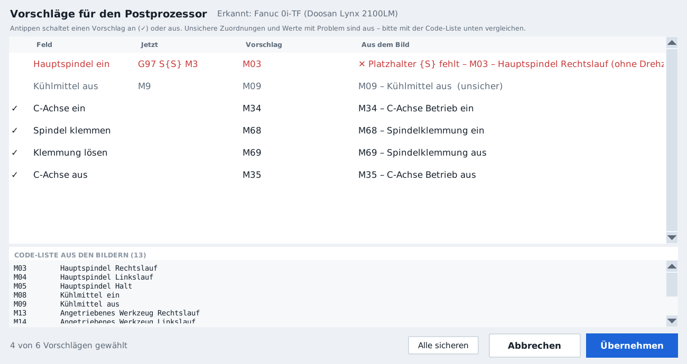

**Zyklus fotografieren → Zyklus:** Taste **Zyklen** im Hauptfenster → **📷 Aus Bild lesen …**,
Foto der Zyklus-Beschreibung (Aufrufzeile, Parametertabelle) oder der Eingabemaske wählen. Das
Programm macht daraus eine Vorlage, z. B. `CYCLE83({RTP},{RFP},{SDIS},{DP},…)` oder
`G83 X{X} Z{Z} R{R} Q{Q} F{F}`, mit Bedeutung und Einheit jedes Parameters. Nach dem Prüfen ist der
Zyklus in der Liste der Maschine: Werte eintragen (Pflichtwerte mit *), unten steht sofort der
NC-Text, **Am Cursor einfügen** schreibt ihn ins Programm. Leere Werte lässt der Zyklus weg – bei
Siemens bleibt die Stelle leer (`CYCLE83(10,0,2,-25,,-5)`), bei Fanuc fällt das Adresswort weg.
Die zuletzt eingetragenen Werte werden je Zyklus gemerkt. Zyklen lassen sich auch von Hand anlegen
(**Neu …**) oder nachbessern (**Bearbeiten …**).

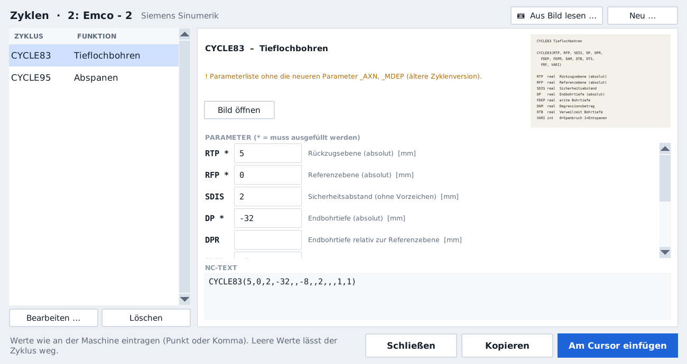

> Gelesen wird mit dem Modell `claude-opus-5-5` (Antwort als festes JSON-Schema). Lehnt das Modell
> eine Anfrage ab, rechnet Anthropic sie automatisch mit einem Ersatzmodell nach. Die Bilder werden
> vor dem Senden verkleinert (lange Kante höchstens 2576 Pixel). Das Ergebnis ist ein Vorschlag –
> M-Befehle und Zyklusparameter mit dem Handbuch vergleichen und den ersten Lauf vorsichtig einfahren.

### Prüfungen

Der Assistent erzeugt lieber keinen Code als einen gefährlichen. Er meldet z. B.:

- Kontur mit Einstich oder Hinterschnitt (Durchmesser wird nach links kleiner)
- Fase/Radius zu groß, Kontur größer als das Rohteil
- Fräser zu groß für Fläche oder Nut, falsches Werkzeug (z. B. axialer Bohrer für eine Querbohrung)
- Entgraten direkt neben einem größeren Absatz (der Kegel des Fasenfräsers käme dagegen)
- Querbohrung, die einen Absatz anschneidet, oder Stirnbohrung hinter einem größeren Durchmesser
- Innen: Bohrstange passt nicht in die Vorbohrung (Dmin), Bohrstange zu kurz bzw. Auskragung über 4×Ø,
  Vorbohrung zu flach oder kleiner als die Innenkontur, Wand zu dünn, Bohrer zu kurz,
  Innenkontur wird nach innen größer

### Grenzen

Noch nicht enthalten: Heidenhain, Einstiche und Hinterschnitte (außen und innen), Gewinde,
TRANSMIT an der Stirnseite. Längsnuten werden mit der Y-Achse gefräst (parallele Wände); Mantelnut und
Entgraten auf dem Mantel laufen mit TRACYL/G07.1. Aus 3D-Modellen werden Einstiche und die Rückseite
(2. Aufspannung) nicht übernommen; Querbohrungen nur aus STEP. Die Ecken einer Nut haben den Fräserradius; die Kanten
an der Stirnseite einer offenen Nut werden nicht entgratet. Die Simulation zeigt den Fasenfräser beim
Mantel-Entgraten vereinfacht (Achse parallel zur Winkellage statt radial gekippt).

> **Wichtig:** Der erzeugte Code ist ein Vorschlag. Vor dem ersten Lauf an der Steuerung
> simulieren bzw. mit reduziertem Eilgang und Vorschub einfahren, Werkzeugdaten und Spannung
> prüfen. Maschinenspezifische M-Befehle (Klemmung, C-Achse) im Postprozessor eintragen.

## Warum sind die Zeilen früher verrutscht?

Steuerungen beenden Zeilen unterschiedlich. Eine **Fanuc** gibt am Zeilenende standardmäßig
die Zeichenfolge `LF CR CR` aus (Parameter 0100#3 NCR = 0), andere Steuerungen `CR LF`,
nur `LF` oder nur `CR`. Außerdem kommen die Daten über die Schnittstelle in beliebig
zerstückelten Blöcken an. Ein Zeilenende kann also genau zwischen zwei Blöcken liegen.
Wer das nicht berücksichtigt, bekommt verschobene Zeilen, Leerzeilen oder zusammengeklebte Sätze.

Das neue Programm erkennt die Art des Zeilenendes automatisch und setzt die Zeilen auch
über Blockgrenzen hinweg korrekt zusammen (`cnc_dnc/textutil.py`, mit Tests für alle
Kombinationen und Aufteilungen). Der Editor bricht keine Zeilen um und benutzt eine
Schrift mit fester Zeichenbreite. Beim Senden bekommt jede Zeile dasselbe, einstellbare
Zeilenende.

## Einstellungen je Maschine

| Bereich | Einstellung | Bedeutung |
|---|---|---|
| Allgemein | Steuerung | Fanuc/ISO, Heidenhain, Sinumerik oder Allgemein. Belegt sinnvolle Vorgaben für Senden und Empfangen. |
| | Programmordner, Dateiendung | Wo empfangene Programme gespeichert werden |
| Schnittstelle | Port, Baudrate, Datenbits, Parität, Stoppbits | Müssen exakt zur Steuerung passen |
| | Handshake | Hardware RTS/CTS, Software XON/XOFF, DTR/DSR oder keiner |
| Senden | Zeilenende | CR+LF (Standard), nur LF, nur CR |
| | % einrahmen | Ergänzt fehlende `%` am Anfang und Ende (Fanuc) |
| | Vorlauf/Nachlauf | Anzahl NUL-Zeichen vor/nach dem Programm, für ältere Steuerungen |
| | Pause je Zeichen/Zeile | Nur bei Maschinen ohne Handshake nötig |
| Empfangen | Programmende erkennen | Zweites alleinstehendes `%`, `END PGM`, M30/M02 oder nur nach Zeit |
| | Beenden nach … s ohne Daten | Zählt erst ab dem ersten empfangenen Zeichen |
| | Steuerzeichen entfernen | Filtert NUL-Vorlauf, XON/XOFF usw. heraus |
| | Automatisch speichern | Speichert jedes empfangene Programm sofort |

Die Einstellungen stehen in `%APPDATA%\CNC-Datenuebertragung\config.json`. Diese Datei
kann man sichern oder auf ein anderes Tablet kopieren. Unerwartete Fehler werden
im selben Ordner in `fehler.log` protokolliert.

## Tastenkürzel

| Taste | Funktion |
|---|---|
| F5 | Senden |
| F6 | Empfangen |
| Strg+O / Strg+S / Strg+Umschalt+S | Öffnen / Speichern / Speichern unter |
| Strg+N | Neu |
| Strg+F | Suchen |
| Strg+Plus / Strg+Minus | Schrift größer / kleiner |
| Strg+Z / Strg+Y | Rückgängig / Wiederholen |

### Bildschirmtastatur

Windows 7 öffnet die Tastatur nur bei seinen eigenen Eingabefeldern von selbst.
Deshalb öffnet das Programm sie selbst, sobald man ein Eingabefeld **antippt**:
Dateiname, Suche, Maschinen-Einstellungen usw. Bloßes Wischen oder eine reine
Auswahlliste öffnet sie nicht. Wird ein Fenster wie „Programm speichern“ geschlossen
oder startet eine Übertragung, blendet das Programm die Tastatur wieder aus.

Unter **⚙ Maschinen** lässt sich das oben einstellen:
- „Automatisch öffnen, wenn ein Eingabefeld angetippt wird“ (Standard: an)
- „Auch beim Antippen des Programm-Editors öffnen“ (Standard: aus, damit beim Lesen
  und Blättern nicht ständig die Tastatur aufspringt)

Die Taste ⌨ oben rechts öffnet bzw. schließt die Tastatur jederzeit von Hand.

### Dateiliste ausblenden

Der Knopf **◀** oben in der Dateiliste blendet sie aus, dann hat der Editor mehr Platz.
**▶ Dateiliste** über dem Editor holt sie zurück.
Mit dem Finger scrollt man im Editor auf der Spalte mit den Zeilennummern oder
über die breiten Scrollbalken, in der Dateiliste direkt in der Liste.

## Für Entwickler

```
cnc_dnc/
  textutil.py     Zeilenenden, Sendeaufbereitung, Programmende, Programmnamen
  kontur.py       Kontur-Assistent: Geometrie, Schruppen/Schlichten, Fräsen auf Winkellagen
  kontur_dialog.py  Fenster „Kontur → Code“ mit Zeichnung zum Antippen
  postpro.py      Postprozessor je Maschine: G-/M-Befehle als Vorlagen, Sinumerik/Fanuc
  postpro_dialog.py  Fenster „Postprozessor“ mit Vorschau
  simulation.py, fraessim.py, sim_dialog.py  Simulation Drehen (Plattenform) und Fräsen
  ki.py           Bilder lesen mit Claude (Anthropic): Code-Listen → Postprozessor, Zyklus-Fotos
  ki_dialog.py    Fenster: API-Schlüssel, Warten, Vorschläge prüfen, Code-Liste
  zyklen.py, zyklus_dialog.py  Zyklen je Maschine: Vorlage ausfüllen, einfügen
  serial_link.py  Schnittstelle, Senden/Empfangen im Hintergrund-Thread
  config.py       Maschinenprofile, Speichern als JSON
  app.py          Hauptfenster
  dialogs.py      Rückfragen, Maschinenliste, Maschinen-Einstellungen
  widgets.py      Touch-Buttons, LEDs, Editor
  theme.py        Farben, Schriften, Stile
tests/            pytest (Text-Logik, echte Übertragung über virtuelles Kabel, Oberfläche,
                  Kontur-Code mit Abtragssimulation: kein Eilgang ins Material, Kontur fertig)
```

Tests (unter Linux inklusive Übertragung über ein virtuelles Schnittstellenpaar und Oberfläche):

```
pip install -r requirements-dev.txt
xvfb-run -a python -m pytest      # unter Windows einfach: python -m pytest
```

Der Code ist bewusst kompatibel zu **Python 3.8**, der letzten Version für Windows 7.
Er braucht nur Tkinter, das bei Python dabei ist, und `pyserial`. Die PC-Version bringt zusätzlich
`anthropic` und Pillow mit (`requirements-pc.txt`); ohne sie bleibt „Bilder lesen“ einfach
ausgeschaltet. Die Tests für das Bilder-Lesen laufen mit einem Schein-Client, ohne echte Anfragen.
