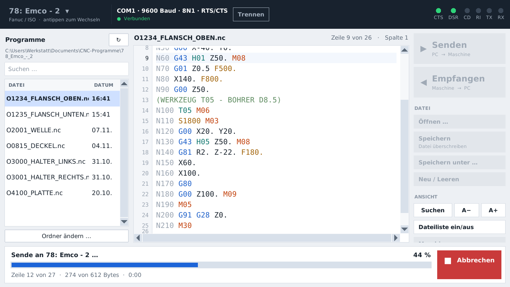

# CNC-Datenübertragung 2.1

Programm zum **Senden** von CNC-Programmen an die Maschine und zum **Empfangen**
(Zurückholen) von der Maschine über die serielle Schnittstelle (RS-232 / COM-Port).
Neuaufbau des alten „Nagel Datenübertragung V1.1“: übersichtlich, mit großen
Tasten für die Bedienung am Tablet (Panasonic Toughbook, Windows 7 und neuer).


## Was ist neu?

- **Keine verrutschten Zeilen mehr.** Siehe [unten](#warum-sind-die-zeilen-früher-verrutscht).
- **Große Touch-Tasten**: Senden, Empfangen, Öffnen, Speichern.
- **Dateiliste der Maschine** links: einmal antippen, und das Programm wird geöffnet.
  Das Windows-Dialogfenster mit seinen winzigen Einträgen braucht man nicht mehr.
- **Editor mit Zeilennummern und farbiger G-Code-Darstellung**: G, M, T, F/S, N und Kommentare
  sind farblich unterschieden. Er bietet Suchen sowie Rückgängig (Strg+Z) und
  Wiederholen (Strg+Y). Die Schriftgröße lässt sich mit A− / A+ ändern.
- **Fortschrittsanzeige beim Senden** mit Zeile, Bytes und Zeit. Wartet die Maschine
  (Handshake), zeigt das Programm das an, statt scheinbar hängen zu bleiben.
- **Empfang mit automatischem Ende**: beim zweiten `%` (Fanuc), bei `END PGM`
  (Heidenhain), bei M30 oder wenn einige Sekunden nichts mehr kommt.
- **Programmname wird automatisch erkannt.** Beim Empfang erscheint der Name sofort
  oben im Editor und auf der Taste „Speichern“. Das Speichern-Fenster schlägt ihn vor.
  Erkannt werden:
  - Sinumerik-Werkstücke: `;$PATH=/_N_WKS_DIR/_N_METLOG_300069_WPD` wird zu **METLOG_300069**
  - Sinumerik-Einzelprogramme: `%_N_WELLE_MPF` wird zu **WELLE**
  - Fanuc: `O1234 (FLANSCH)` wird zu **O1234_FLANSCH**
  - Heidenhain: `BEGIN PGM PLATTE` wird zu **PLATTE**
- **Sprungliste für Unterprogramme**: Stehen mehrere Programme in einer Datei
  (z. B. ABSTECH, KANAL1, KANAL2 … in einem Sinumerik-Werkstück), springt man über
  „≡ 8 Programme ▾“ direkt dorthin.


- **Maschinenliste** mit allen Schnittstellen-Einstellungen je Maschine.
- **LEDs für die Steuerleitungen** CTS, DSR, CD und RI sowie TX/RX, wie im alten Programm.
- **Warnung vor Sonderzeichen** (ä, ö, ü, Ø …), die viele Steuerungen mit Alarm ablehnen.
- Klare Fehlermeldungen auf Deutsch, z. B. „COM1 ist belegt. Läuft noch ein anderes Programm?“



## Installation

### Variante A: fertige EXE (empfohlen)

Bei jedem Hochladen baut GitHub automatisch die Datei `CNC-Datenuebertragung.exe`:

1. Auf GitHub im Repository auf **Actions** gehen, dann **Windows-Programm bauen** wählen
   und den neuesten grünen Lauf öffnen.
2. Unten bei **Artifacts** die Datei **CNC-Datenuebertragung-Windows** herunterladen und entpacken.
3. `CNC-Datenuebertragung.exe` auf das Tablet kopieren, z. B. auf den Desktop, und starten.
   Eine Installation ist nicht nötig.

Wenn ein Versions-Tag (z. B. `v2.0.0`) angelegt wird, erscheint die EXE zusätzlich unter **Releases**.

Die EXE wird mit Python 3.8 (32 Bit) gebaut. Damit läuft sie auch unter **Windows 7**,
egal ob 32 oder 64 Bit.

> **Windows 7:** Erscheint beim Start eine Meldung wie „api-ms-win-crt-runtime-l1-1-0.dll fehlt“,
> fehlt das Windows-Update **KB2999226** (Universal C Runtime). Nach der Installation
> dieses Updates startet das Programm.

Die EXE kann man auch selbst bauen: Auf einem Windows-PC mit Python 3.8 einfach
`build_exe.bat` doppelklicken. Danach liegt sie in `dist\`.

### Variante B: direkt mit Python

1. Python installieren. Für Windows 7 muss es **Python 3.8.10** sein
   (https://www.python.org/downloads/release/python-3810/), bei der Installation
   „Add Python to PATH“ ankreuzen.
2. Eingabeaufforderung öffnen und `pip install pyserial` eingeben.
3. `CNC-Datenuebertragung.pyw` doppelklicken.

## Erste Schritte

1. Oben links auf den Maschinennamen tippen, dann **Bearbeiten …**
2. Unter **Schnittstelle** die Werte der Steuerung eintragen. Für die „78: Emco - 2“
   sind die Werte aus dem alten Programm schon vorbelegt: COM1, 9600 Baud, 8 Datenbits,
   keine Parität, 1 Stoppbit, Hardware-Handshake.
3. Unter **Allgemein** den Programmordner festlegen, wenn die Programme nicht unter
   `Dokumente\CNC-Programme\<Maschine>` liegen sollen.
4. Weitere Maschinen mit **Neue Maschine …** oder **Kopieren** anlegen.

Wichtig: Das alte Programm muss geschlossen sein, sonst ist der COM-Port belegt.

### Programm an die Maschine senden

1. Programm links in der Liste antippen oder über **Öffnen …** laden.
2. An der Steuerung das Einlesen starten (z. B. Fanuc: EDIT → READ → EXEC).
3. **Senden** antippen. Der Balken unten zeigt den Fortschritt, **Abbrechen** stoppt sofort.

Die Reihenfolge von Schritt 2 und 3 ist bei Hardware-Handshake egal, denn das Programm
wartet, bis die Steuerung bereit ist.

### Programm von der Maschine holen

1. **Empfangen** antippen. Unten erscheint „Bereit – jetzt an der Steuerung die Ausgabe starten“.
2. An der Steuerung die Ausgabe starten (z. B. Fanuc: EDIT → PUNCH → EXEC).
3. Der Text läuft live in den Editor. Das Ende wird automatisch erkannt. Mit
   **Empfang beenden** lässt sich der Empfang auch von Hand abschließen.
4. **Speichern** antippen. Es öffnet sich ein Fenster mit dem erkannten Namen
   (z. B. `METLOG_300069`). Dort kann man ihn übernehmen oder ändern und die Endung
   wählen (`.txt`, `.nc`, `.mpf` …). Die gewählte Endung merkt sich das Programm je Maschine.
   Gibt es die Datei schon, warnt das Fenster. „+ Datum anhängen“ macht daraus z. B.
   `METLOG_300069_2026-11-10`.
   Unter Maschine → Empfangen kann man stattdessen „automatisch speichern“ einschalten.
   Dann wird ohne Fenster gespeichert, und vorhandene Dateien werden nie überschrieben.

Ist eine Datei schon gespeichert, überschreibt **Speichern** sie direkt.
**Speichern unter …** öffnet das Fenster, um einen anderen Namen oder Ordner zu wählen.

### Sinumerik-Werkstücke mit mehreren Programmen

Ein Werkstück wie `METLOG_300069` enthält mehrere Programme hintereinander, jedes mit
eigenem Kopf `%_N_…_MPF`. Darauf ist das Programm eingestellt:

- Ein `%_N_…`-Kopf beendet den Empfang nicht. Als Programmende zählt nur ein `%`,
  das allein in der Zeile steht (Fanuc).
- Beim Senden wird so ein Werkstück nicht zusätzlich mit `%` eingerahmt.
- Klammern wie `GETD(Z12)` werden nicht als Kommentar eingefärbt.
- Für Sinumerik-Maschinen empfiehlt sich als Programmende „Nur nach Zeit ohne Daten“.
  M30 und M17 kommen in einem Werkstück mehrfach vor und taugen deshalb nicht als Ende.

## Warum sind die Zeilen früher verrutscht?

Steuerungen beenden Zeilen unterschiedlich. Eine **Fanuc** gibt am Zeilenende standardmäßig
die Zeichenfolge `LF CR CR` aus (Parameter 0100#3 NCR = 0), andere Steuerungen `CR LF`,
nur `LF` oder nur `CR`. Außerdem kommen die Daten über die Schnittstelle in beliebig
zerstückelten Blöcken an. Ein Zeilenende kann also genau zwischen zwei Blöcken liegen.
Wer das nicht berücksichtigt, bekommt verschobene Zeilen, Leerzeilen oder zusammengeklebte Sätze.

Das neue Programm erkennt die Art des Zeilenendes automatisch und setzt die Zeilen auch
über Blockgrenzen hinweg korrekt zusammen (`cnc_dnc/textutil.py`, mit Tests für alle
Kombinationen und Aufteilungen). Der Editor bricht keine Zeilen um und benutzt eine
Schrift mit fester Zeichenbreite. Beim Senden bekommt jede Zeile dasselbe, einstellbare
Zeilenende.

## Einstellungen je Maschine

| Bereich | Einstellung | Bedeutung |
|---|---|---|
| Allgemein | Steuerung | Fanuc/ISO, Heidenhain, Sinumerik oder Allgemein. Belegt sinnvolle Vorgaben für Senden und Empfangen. |
| | Programmordner, Dateiendung | Wo empfangene Programme gespeichert werden |
| Schnittstelle | Port, Baudrate, Datenbits, Parität, Stoppbits | Müssen exakt zur Steuerung passen |
| | Handshake | Hardware RTS/CTS, Software XON/XOFF, DTR/DSR oder keiner |
| Senden | Zeilenende | CR+LF (Standard), nur LF, nur CR |
| | % einrahmen | Ergänzt fehlende `%` am Anfang und Ende (Fanuc) |
| | Vorlauf/Nachlauf | Anzahl NUL-Zeichen vor/nach dem Programm, für ältere Steuerungen |
| | Pause je Zeichen/Zeile | Nur bei Maschinen ohne Handshake nötig |
| Empfangen | Programmende erkennen | Zweites alleinstehendes `%`, `END PGM`, M30/M02 oder nur nach Zeit |
| | Beenden nach … s ohne Daten | Zählt erst ab dem ersten empfangenen Zeichen |
| | Steuerzeichen entfernen | Filtert NUL-Vorlauf, XON/XOFF usw. heraus |
| | Automatisch speichern | Speichert jedes empfangene Programm sofort |

Die Einstellungen stehen in `%APPDATA%\CNC-Datenuebertragung\config.json`. Diese Datei
kann man sichern oder auf ein anderes Tablet kopieren. Unerwartete Fehler werden
im selben Ordner in `fehler.log` protokolliert.

## Tastenkürzel

| Taste | Funktion |
|---|---|
| F5 | Senden |
| F6 | Empfangen |
| Strg+O / Strg+S / Strg+Umschalt+S | Öffnen / Speichern / Speichern unter |
| Strg+N | Neu |
| Strg+F | Suchen |
| Strg+Plus / Strg+Minus | Schrift größer / kleiner |
| Strg+Z / Strg+Y | Rückgängig / Wiederholen |

Auf dem Tablet öffnet die Taste ⌨ oben rechts die Bildschirmtastatur.
Mit dem Finger scrollt man im Editor auf der Spalte mit den Zeilennummern oder
über die breiten Scrollbalken, in der Dateiliste direkt in der Liste.

## Für Entwickler

```
cnc_dnc/
  textutil.py     Zeilenenden, Sendeaufbereitung, Programmende, Programmnamen
  serial_link.py  Schnittstelle, Senden/Empfangen im Hintergrund-Thread
  config.py       Maschinenprofile, Speichern als JSON
  app.py          Hauptfenster
  dialogs.py      Rückfragen, Maschinenliste, Maschinen-Einstellungen
  widgets.py      Touch-Buttons, LEDs, Editor
  theme.py        Farben, Schriften, Stile
tests/            pytest (Text-Logik, echte Übertragung über virtuelles Kabel, Oberfläche)
```

Tests (unter Linux inklusive Übertragung über ein virtuelles Schnittstellenpaar und Oberfläche):

```
pip install -r requirements-dev.txt
xvfb-run -a python -m pytest      # unter Windows einfach: python -m pytest
```

Der Code ist bewusst kompatibel zu **Python 3.8**, der letzten Version für Windows 7.
Er braucht nur Tkinter, das bei Python dabei ist, und `pyserial`.
